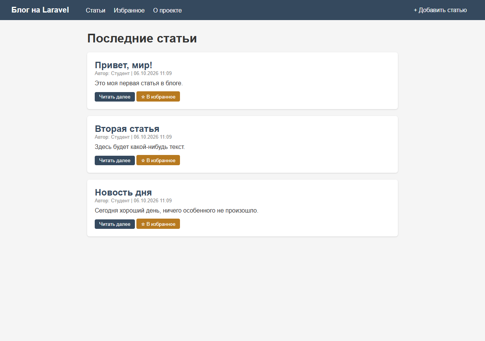
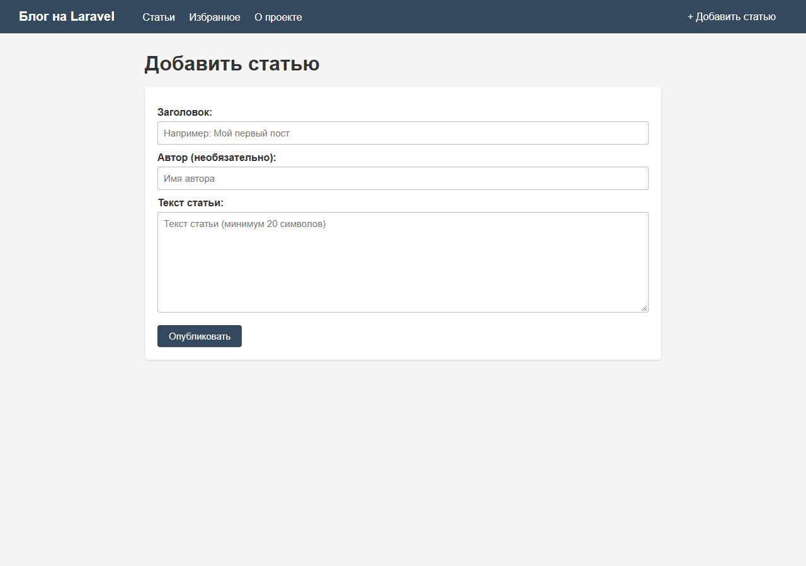
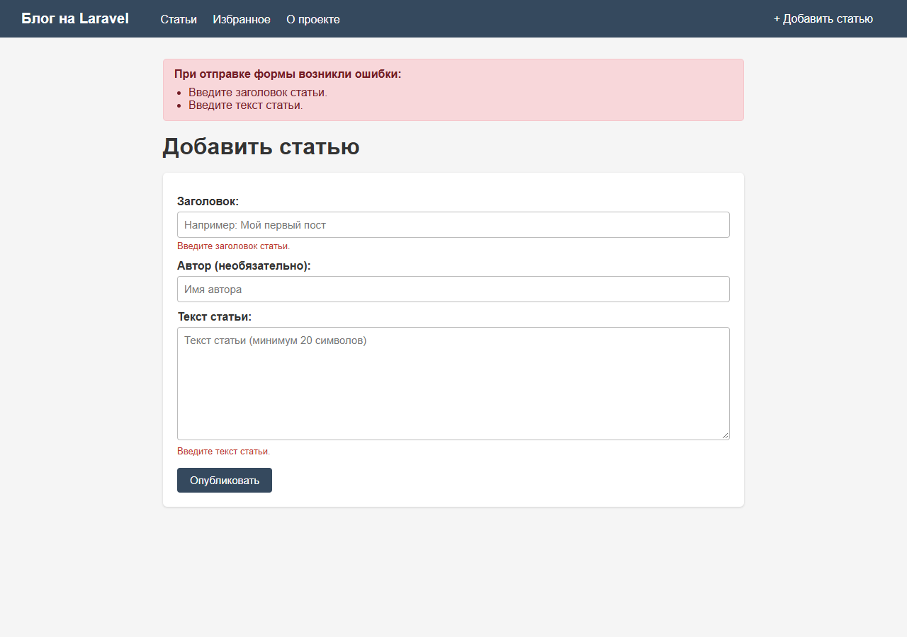
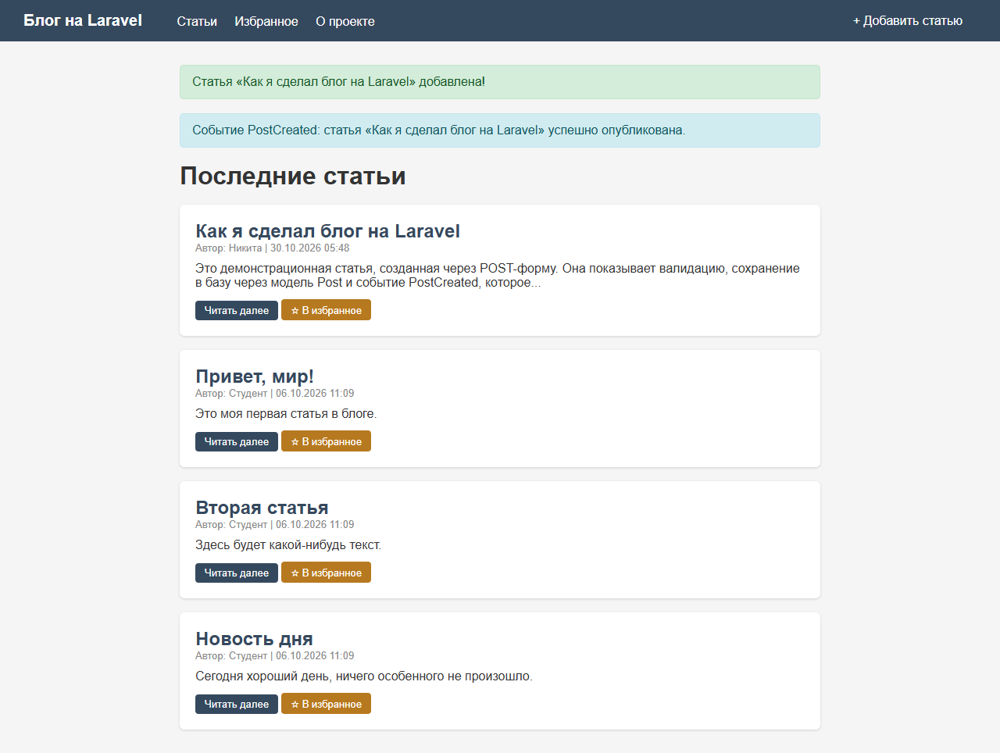
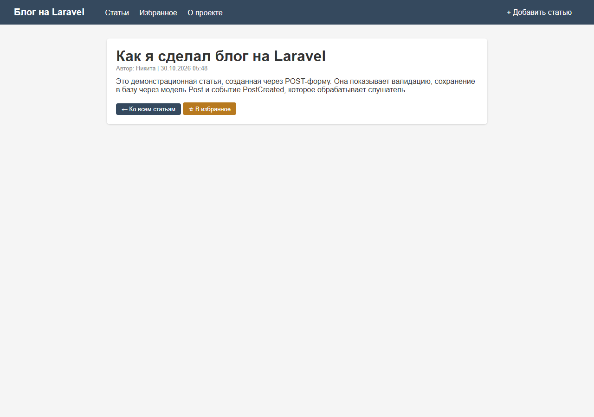
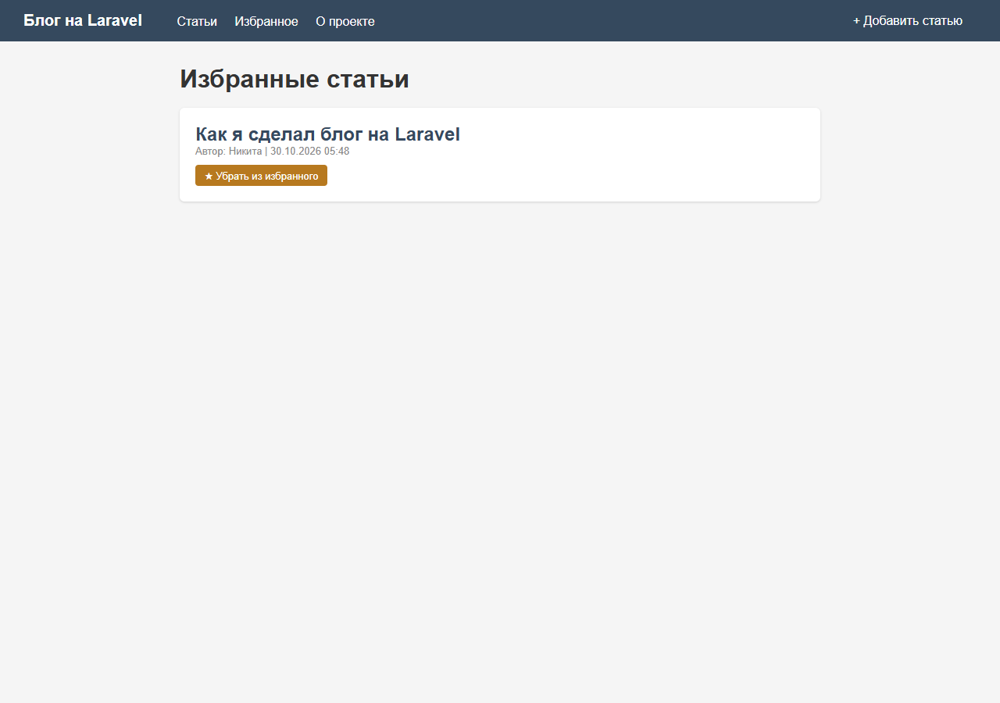

# Блог на Laravel

Учебный проект — блог, в котором последовательно показаны пять тем работы с Laravel:

1. роутинг, контроллеры и шаблоны Blade;
2. модели Eloquent и миграции;
3. приём и валидация данных POST-формы;
4. работа с сессиями;
5. создание и обработка событий.

Проект работает на **Laravel 13**, **PHP 8.3+** и **SQLite**, интерфейс — Blade-шаблоны с общим layout.

## Скриншоты

| Главная страница | Создание статьи |
|---|---|
|  |  |

| Ошибки валидации | Статья создана, событие обработано |
|---|---|
|  |  |

| Страница статьи | Избранное (сессия) |
|---|---|
|  |  |

Остальные скриншоты лежат в [`docs/screenshots`](docs/screenshots): добавление в избранное (`06-favorite-added.png`) и счётчик посещений (`08-about.png`).

## Соответствие заданию

| № | Пункт задания | Где реализовано |
|---|---|---|
| 1 | **Роутинг, контроллеры, шаблоны** | Маршруты — [`routes/web.php`](routes/web.php); контроллеры — [`PostController`](app/Http/Controllers/PostController.php) и [`PageController`](app/Http/Controllers/PageController.php); шаблоны — [`resources/views`](resources/views) (общий [`layout.blade.php`](resources/views/layout.blade.php), страницы в `posts/` и `pages/`). Используются именованные маршруты, route-модели (`/posts/{post}`), `@extends`, `@section`, `@yield`, `@foreach`, `@if`. |
| 2 | **Модели и миграции** | Модель [`Post`](app/Models/Post.php) с `$fillable`; миграция [`create_posts_table`](database/migrations/2026_10_06_000001_create_posts_table.php); сидер [`PostSeeder`](database/seeders/PostSeeder.php). Таблицы создаются командами `php artisan migrate` / `migrate --seed`. |
| 3 | **Приём и валидация POST-формы** | Метод [`PostController@store`](app/Http/Controllers/PostController.php#L31-L59): `$request->validate([...])` с правилами `required`, `min`, `max`, `nullable` и русскими сообщениями об ошибках. Форма [`create.blade.php`](resources/views/posts/create.blade.php) отправляет POST с `@csrf`, сохраняет введённое через `old()` и выводит ошибки через `@error`. |
| 4 | **Работа с сессиями** | Избранное статей: `session('favorites')`, `$request->session()->put(...)` в [`toggleFavorite`](app/Http/Controllers/PostController.php#L83-L98). Flash-сообщения `success` и `event`. Счётчик посещений `/about` в [`PageController@about`](app/Http/Controllers/PageController.php). Сессии хранятся в БД (`SESSION_DRIVER=database`). |
| 5 | **Создание и обработка событий** | Событие [`App\Events\PostCreated`](app/Events/PostCreated.php) с объектом статьи; слушатель [`App\Listeners\LogPostCreated`](app/Listeners/LogPostCreated.php) пишет запись в лог и flash-сообщение. Событие генерируется в контроллере: `event(new PostCreated($post))`. Регистрация — автоматическое обнаружение Laravel (проверяется командой `php artisan event:list`). |

## Быстрый старт

Требования: PHP 8.3+, Composer, расширения `pdo_sqlite` и `mbstring`.

```bash
composer install
cp .env.example .env
php artisan key:generate

# файл базы SQLite
touch database/database.sqlite        # Windows: type nul > database\database.sqlite

php artisan migrate --seed
php artisan serve
```

Приложение откроется по адресу <http://127.0.0.1:8000>.

> В `.env` уже выбраны `DB_CONNECTION=sqlite` и `SESSION_DRIVER=database`, поэтому отдельно настраивать БД не нужно.

## Тесты

```bash
php artisan test
```

Покрыты все ключевые сценарии (8 тестов): список статей, открытие формы, успешное создание с проверкой события `PostCreated`, отклонение невалидных данных, хранение избранного в сессии и счётчик посещений.

```text
Tests:    8 passed (19 assertions)
```

## Ручная проверка пунктов

1. **Роутинг и шаблоны.** Откройте `/`, `/about`, `/posts/create`, `/posts/1` — все страницы строятся на общем layout. Список маршрутов: `php artisan route:list`.
2. **Модель и миграция.** `php artisan migrate:status` показывает миграцию `create_posts_table`; статьи читаются через `Post::latest()->get()`.
3. **POST и валидация.** На `/posts/create` отправьте пустую форму — появятся ошибки «Введите заголовок статьи» и «Введите текст статьи», введённые значения сохранятся. Заполните поля корректно — статья сохранится, произойдёт редирект с flash-сообщением.
4. **Сессии.** Нажмите «☆ В избранное» — статья попадёт на `/favorites`; счётчик на `/about` увеличивается при каждом обновлении. Всё это хранится в сессии.
5. **События.** После создания статьи на главной появляется сообщение «Событие PostCreated: статья … успешно опубликована», а в `storage/logs/laravel.log` — запись:

   ```text
   local.INFO: Опубликована новая статья: «…» (автор: …)
   ```

   Список зарегистрированных событий: `php artisan event:list`.

## Структура проекта

```text
app/
├── Events/PostCreated.php          # событие «статья опубликована»
├── Http/Controllers/
│   ├── PageController.php          # страница «О проекте»
│   └── PostController.php          # статьи, избранное, валидация
├── Listeners/LogPostCreated.php    # обработчик события
└── Models/Post.php                 # модель статьи
database/
├── migrations/…_create_posts_table.php
└── seeders/PostSeeder.php
resources/views/
├── layout.blade.php                # общий шаблон
├── pages/about.blade.php
└── posts/{index,create,show,favorites}.blade.php
routes/web.php                      # маршруты
tests/Feature/PostTest.php          # функциональные тесты
docs/screenshots/                   # скриншоты работы
```

## Технические детали

- CSRF-защита включена для всех POST-форм (`@csrf`).
- Валидация выполняется в контроллере, ошибки возвращаются в сессии и выводятся в шаблоне.
- Слушатель события подключается автоматически: Laravel находит `handle(PostCreated $event)` в `app/Listeners`. Явная регистрация через `Event::listen()` не требуется.
- SQLite-файл и `.env` исключены из репозитория (`.gitignore`); схема и тестовые данные воспроизводятся командами `migrate --seed`.

## Лицензия

Учебный проект. Laravel распространяется по лицензии [MIT](https://opensource.org/licenses/MIT).
